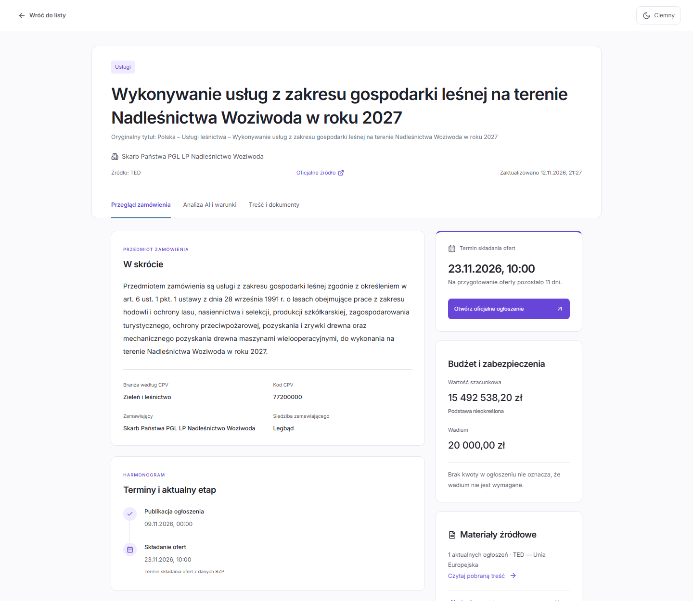
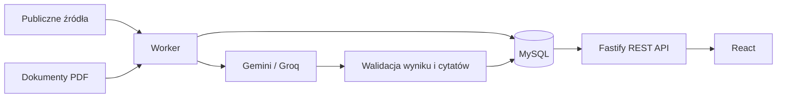
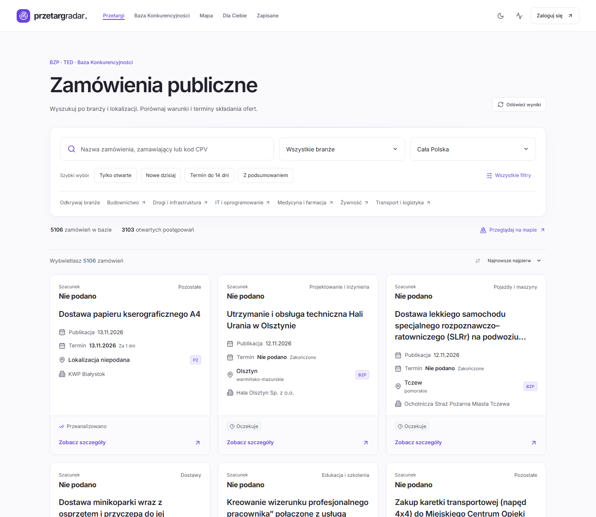
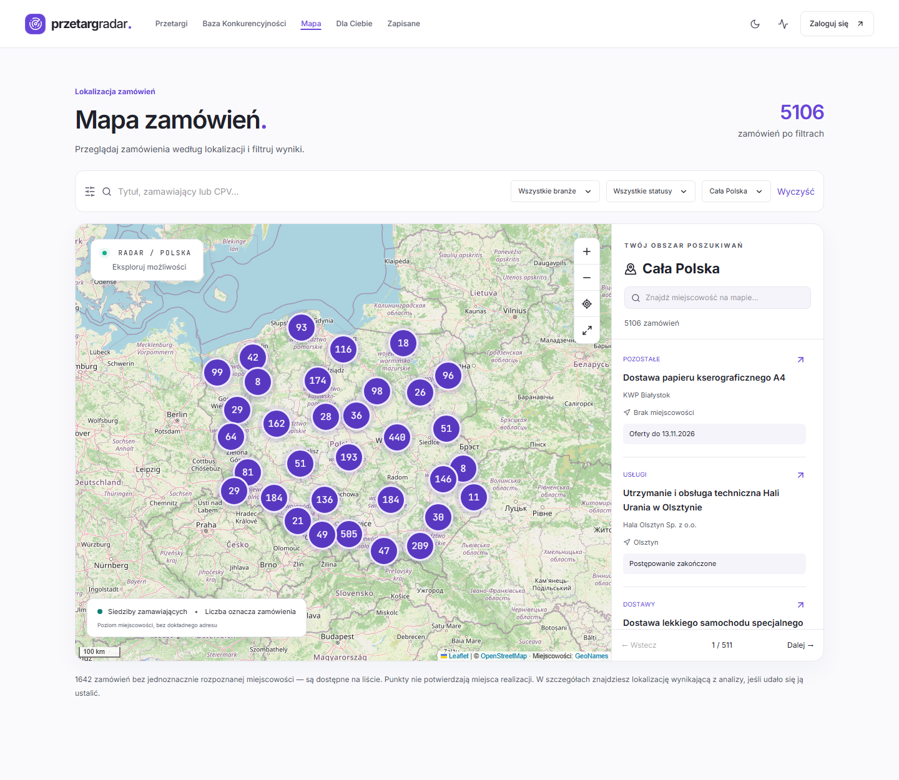
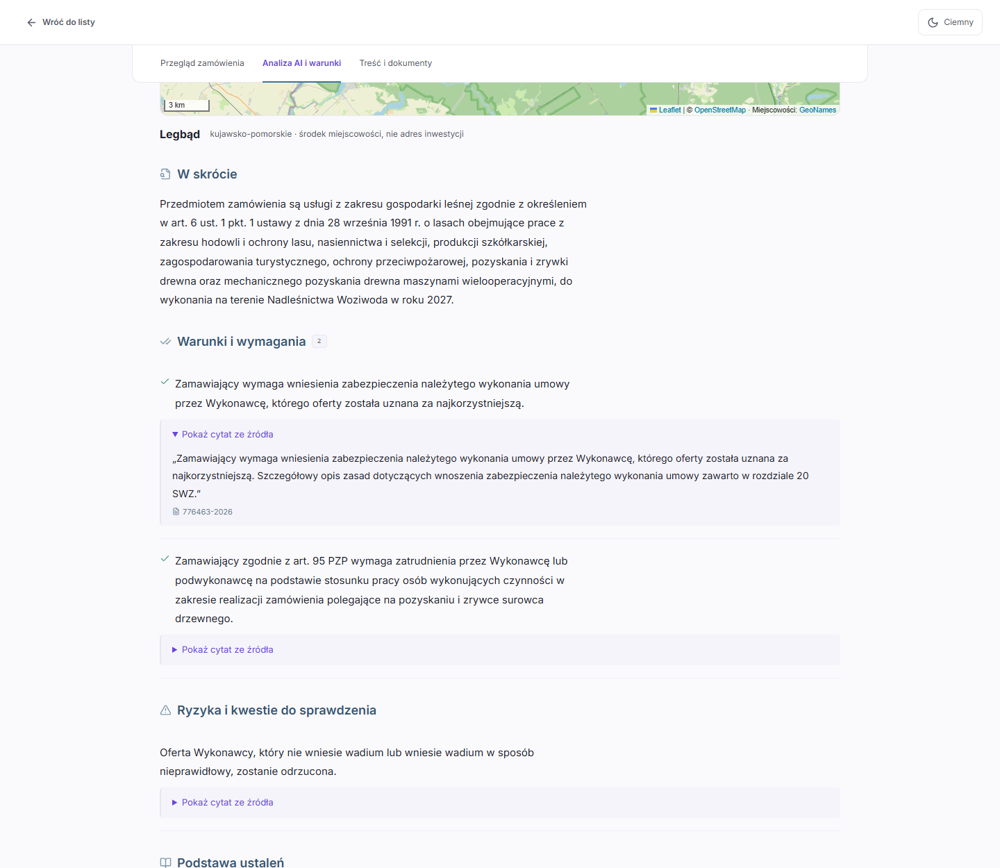
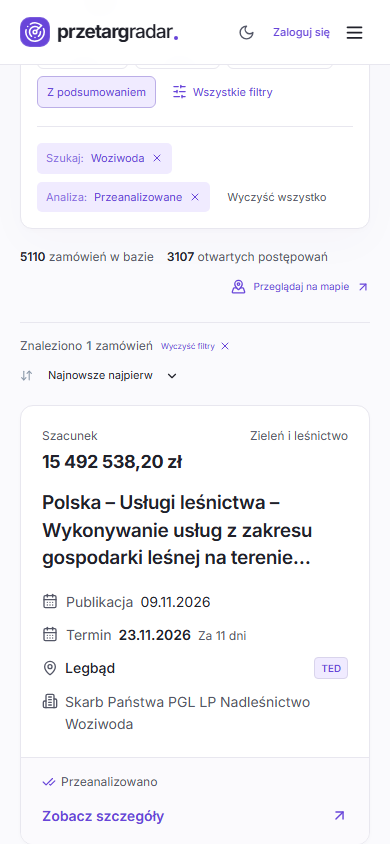

# PrzetargRadar

Aplikacja webowa do przeglądania polskich zamówień publicznych. Zbiera ogłoszenia z kilku źródeł, zapisuje je w MySQL i pomaga porównać terminy, wymagania oraz dokumenty postępowania.

**[Zobacz działającą aplikację →](https://przetargi.toolify.com.pl/)**



## Funkcje

- Ogłoszenia z BZP/e-Zamówień, TED, Bazy Konkurencyjności i platformazakupowa.pl.
- Wyszukiwanie, 22 branże według CPV, województwa, miasta, źródła i terminy. Filtry oraz numer strony są zapisywane w adresie URL.
- Konta użytkowników, zapisane oferty i dopasowania na podstawie profilu firmy.
- Mapa zamawiających z grupowaniem punktów i filtrowaniem wyników.
- Podsumowanie AI, wymagania, ryzyka, szacunkowa wartość i wadium. Wynik zawiera cytaty, które backend sprawdza względem materiału źródłowego.
- Pobieranie dostępnych PDF-ów, lokalna ekstrakcja tekstu i OCR skanów. Interfejs pokazuje, które dokumenty uwzględniono, a których nie udało się odczytać.
- Osobny worker do synchronizacji, dokumentów i kolejki analiz. Odświeżenie strony nie uruchamia płatnego zapytania do AI.

## Technologie

| Część                | Rozwiązanie                                                                             |
| -------------------- | --------------------------------------------------------------------------------------- |
| Frontend             | React 19, TypeScript, Vite, TanStack Query, Radix UI, Tailwind CSS i własne arkusze CSS |
| Backend              | Node.js, Fastify, Zod, REST API                                                         |
| Baza                 | MySQL 8.4, Prisma, migracje                                                             |
| Analizy              | Gemini i Groq, cache wyników, kolejka z limitami RPM/TPM i budżetem dziennym            |
| Dokumenty i mapa     | Poppler, Tesseract OCR, Leaflet, OpenStreetMap, GeoNames                                |
| Testy i uruchomienie | Vitest, Playwright, GitHub Actions, Docker Compose, nginx                               |

## Architektura



API obsługuje przeglądarkę, a worker niezależnie pobiera nowe dane. Oba procesy korzystają ze wspólnej bazy. Zadania mają blokadę czasową, więc po awarii workera można je przejąć ponownie. Hash materiałów pozwala pominąć analizę, jeżeli tekst się nie zmienił.

Więcej szczegółów: [architektura](docs/architecture.md) i [API](docs/api.md).

## Uruchomienie lokalne

Najprościej przez Docker Compose. Nie trzeba osobno instalować MySQL, Node.js ani narzędzi OCR.

```bash
cp .env.example .env
docker compose up -d --build
docker compose --profile tools run --rm seed
```

W PowerShell zamiast `cp` można użyć `Copy-Item .env.example .env`.

Otwórz **http://localhost:8080**. Pierwszy build może potrwać kilka minut. Tryb `DEMO` używa przykładowych ogłoszeń i deterministycznych analiz, bez kluczy i wywołań płatnych API. Nie ma gotowego konta — można zarejestrować własne.

Wersja dostępna pod publicznym adresem korzysta z rzeczywistych danych. Konfigurację trybu LIVE i lokalną pracę nad kodem opisuje [instrukcja uruchomienia](docs/setup.md).

## Testy

Do pracy poza Dockerem: Node.js 26 i pnpm 10.33.2.

```bash
pnpm install --frozen-lockfile
pnpm db:generate
pnpm typecheck
pnpm test
pnpm build
pnpm exec playwright install chromium
pnpm exec playwright test --config playwright.ui.config.ts
```

Test interfejsu powyżej podstawia odpowiedzi API i nie potrzebuje MySQL. Testy integracyjne oraz pełne scenariusze e2e wymagają osobnej bazy testowej i uruchomionych usług — [szczegóły](docs/testing.md).

## Zrzuty ekranu





<details>
<summary>Analiza i wersja mobilna</summary>





</details>

Screenshoty pochodzą z publicznej aplikacji, wykonane 12 listopada 2026 r. Dane i liczby w serwisie zmieniają się podczas synchronizacji.

## Dokumentacja

- [Architektura i przepływ danych](docs/architecture.md)
- [Endpointy API](docs/api.md)
- [Konfiguracja i tryb LIVE](docs/setup.md)
- [Testy](docs/testing.md)
- [Źródła danych i obsługiwane dokumenty](docs/data-and-limits.md)
- [Atrybucje](THIRD_PARTY_NOTICES.md)
